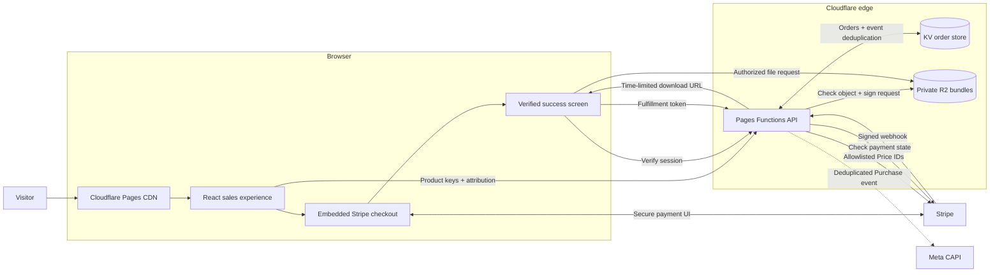

<p align="center">
  <a href="https://radioreach.us" aria-label="Visit RadioReach">
    
  </a>
</p>

<h1 align="center">RadioReach Funnel</h1>

<p align="center">
  <strong>A conversion-focused, edge-native storefront that turns discovery into secure digital delivery.</strong>
</p>

<p align="center">
  RadioReach combines an adaptive React sales experience, Stripe Embedded Checkout,<br />
  verified Cloudflare fulfillment, and private R2 downloads in one production commerce flow.
</p>

<p align="center">
  <a href="https://radioreach.us"><strong>View the live experience</strong></a>
  ·
  <a href="./CLOUDFLARE_STRIPE_R2_SETUP.md">Commerce setup</a>
  ·
  <a href="./DEPLOY.md">Deployment guide</a>
</p>

<p align="center">
  
  
  
  
</p>

---

## Overview

**RadioReach Funnel** is the production commerce experience behind [RadioReach](https://radioreach.us), a radio-promotion resource for independent musicians. It takes a visitor from a long-form, mobile-first sales page through an on-page payment experience and into verified, private file delivery—without requiring a traditional always-on application server.

The frontend is a React and TypeScript application deployed on Cloudflare Pages. Commerce and fulfillment run through Cloudflare Pages Functions, Stripe, KV, and a private R2 bucket. Product selection, payment confirmation, attribution, order state, and download authorization are carried across the entire journey.

> [!IMPORTANT]
> This is a private production storefront, not a reusable checkout template. Use Stripe test mode and non-production Cloudflare resources for local development and preview deployments.

## What makes it different

| Capability | Implementation |
| --- | --- |
| **Conversion-led experience** | Responsive long-form sales page, interactive proof, offer stacking, exit intent, sticky CTAs, checkout add-ons, modular upsell screens, and a focused post-purchase journey. |
| **Adaptive copy system** | The Emotional State Proxy (ESP) interprets passive behavioral signals and gently adjusts tone—never price, offer terms, or product facts. |
| **Conversion experiment lab** | A behavioral-science shelf of 19 flag-gated experiment prototypes (variable rewards, goal gradients, streaks, anchoring, decoys, endowment framing…) with hypothesis cards, deterministic visitor bucketing, attribution snapshots, and a full test suite — reviewed at `#/lab`. |
| **First-party intent capture** | A feature-flagged Momentum + Ownership sequence records low-cardinality intent and carries it into Stripe metadata, fulfillment, and analytics. |
| **Embedded payments** | Stripe Embedded Checkout keeps delivery and payment details inside the branded experience while Stripe handles sensitive card data. |
| **Verified fulfillment** | Signed Stripe webhooks, idempotent KV order records, HMAC fulfillment tokens, and server-generated R2 URLs ensure files unlock only for paid items. |
| **Edge-native operations** | Static assets and serverless functions deploy together on Cloudflare Pages, with no persistent origin server to provision or maintain. |
| **Measurement-ready** | UTM capture, Meta Pixel, server-side Meta Conversions API, browser/server event deduplication, `dataLayer`, and first-party DOM analytics events. |
| **Search and performance foundations** | Structured data, Open Graph metadata, sitemap, resource pages, responsive imagery, route-level code splitting, security headers, and accessible interaction patterns. |

## Customer journey

1. **Discover** — the visitor enters a responsive, SEO-aware sales experience built for independent artists.
2. **Engage** — ESP and the Momentum sequence respond to behavior and intent while preserving the underlying offer.
3. **Configure** — the buyer selects the core vault and optional add-ons; totals update immediately.
4. **Pay** — the browser sends product keys—not trusted prices—to a Pages Function, which resolves server-allowlisted Stripe Price IDs.
5. **Confirm** — Stripe sends a signed webhook; the function verifies it and writes an idempotent order record to KV.
6. **Unlock** — the success screen verifies both Stripe payment state and the stored order before requesting a signed fulfillment token.
7. **Deliver** — the download endpoint authorizes only purchased products and returns time-limited URLs for objects in private R2 storage.
8. **Measure** — purchase events are sent through browser and server channels with a shared Stripe session ID for deduplication.

## Architecture



### Security model

- **Stripe owns card-data collection.** The application never renders or processes raw card number, expiry, or CVC fields.
- **The browser submits product keys, not prices.** Pages Functions map those keys to a server-side allowlist of configured Stripe Price IDs.
- **Webhook signatures are verified against the raw request body** before an order can become eligible for fulfillment.
- **Webhook events are deduplicated in KV** to make retries safe and prevent duplicate downstream conversion events.
- **Success-page access alone cannot fulfill an order.** Stripe payment state and the KV order record must both verify.
- **Fulfillment tokens are HMAC-SHA256 signed and expire.** Download requests with missing, altered, or expired tokens are rejected.
- **R2 remains private.** Purchased objects are exposed only through scoped, time-limited presigned URLs.
- **Secrets remain server-side.** Only `VITE_*` values are compiled into the browser bundle.

## Technology stack

| Layer | Technology | Responsibility |
| --- | --- | --- |
| UI | React 19, TypeScript | Funnel stages, checkout state, adaptive content, delivery UI |
| Styling | Tailwind CSS 4 | Responsive design system, motion, and accessible states |
| Build | Vite 7 | Development server, optimization, and production bundling |
| Payments | Stripe Checkout + Stripe.js | Embedded payment collection, sessions, invoices, and webhooks |
| Runtime | Cloudflare Pages + Pages Functions | Static delivery and edge API routes |
| State | Cloudflare KV | Order records, fulfillment status, and webhook idempotency |
| Files | Cloudflare R2 + AWS S3 SDK | Private bundle storage and presigned download URLs |
| Analytics | Meta Pixel, Meta CAPI, `dataLayer` | Funnel events, attribution, and browser/server purchase deduplication |
| Tests | jsdom + custom TypeScript runner | ESP decision logic and browser-level integration scenarios |

## Repository layout

```text
radioreach-funnel/
├── functions/
│   ├── _lib/                    # Stripe, KV, R2, token, and analytics helpers
│   └── api/                     # Checkout, verification, webhook, and download routes
├── public/
│   ├── images/                  # Production artwork and responsive media
│   ├── resources/               # Search-focused editorial landing pages
│   ├── privacy-policy/          # Static privacy policy
│   └── terms/                   # Static terms page
├── scripts/                     # ESP unit/integration test harness and asset tooling
├── src/
│   ├── config/                  # Storefront catalog and feature controls
│   ├── esp/                     # Emotional State Proxy engine and adaptive copy
│   ├── funnel/                  # Sales, checkout, upsell, and success experiences
│   ├── lab/                     # Conversion Lab: experiment catalog + 14 prototypes (#/lab)
│   ├── lib/                     # API, attribution, and analytics clients
│   └── App.tsx                  # Funnel orchestration, success routing, lab route
├── CLOUDFLARE_STRIPE_R2_SETUP.md
├── DEPLOY.md
├── vite.config.ts
└── wrangler.jsonc
```

## Getting started

### Prerequisites

- **Node.js 22.22+** recommended for the current Vite and jsdom toolchain
- **npm**
- A **Stripe** account for checkout testing
- A **Cloudflare** account with Pages, KV, and R2 for end-to-end development
- Optional: the [Stripe CLI](https://docs.stripe.com/stripe-cli) for local webhook forwarding

### Install

```bash
git clone https://github.com/zazieproductions/radioreach-funnel.git
cd radioreach-funnel
npm ci
```

### Frontend development

Create `.env.local` with a Stripe **test-mode** publishable key:

```dotenv
VITE_STRIPE_PUBLISHABLE_KEY=pk_test_your_key_here

# Optional feature controls; both default to enabled.
VITE_ESP_ENABLED=true
VITE_MOMENTUM_SEQUENCE_ENABLED=true
```

Then start Vite:

```bash
npm run dev
```

The sales experience and client interactions work in Vite. Checkout, webhook verification, KV order state, and private downloads require the Cloudflare Functions runtime described below.

### Full-stack local development

Create a local `.dev.vars` file for Pages Functions. **Never commit this file.**

```dotenv
# Stripe
STRIPE_SECRET_KEY=sk_test_your_key_here
STRIPE_WEBHOOK_SECRET=whsec_your_local_webhook_secret
STRIPE_PRICE_VAULT_CORE=price_...
STRIPE_PRICE_CONTRACT_BUNDLE=price_...
STRIPE_PRICE_AUSTRALIA_ADDON=price_...
STRIPE_PRICE_AIRPLAY_ACCELERATOR=price_...
STRIPE_PRICE_UPWORK_COURSE=price_...

# Application
PUBLIC_APP_URL=http://localhost:8788
APP_SECRET=replace_with_a_long_random_secret

# Private R2 access
R2_ACCOUNT_ID=your_cloudflare_account_id
R2_ACCESS_KEY_ID=your_r2_access_key
R2_SECRET_ACCESS_KEY=your_r2_secret_key
R2_BUCKET_NAME=your_private_bucket_name

# Optional Meta Conversions API
META_PIXEL_ID=
META_CAPI_ACCESS_TOKEN=
META_TEST_EVENT_CODE=
```

Build the frontend and serve it together with Pages Functions:

```bash
npm run build
npx wrangler pages dev dist --port 8788
```

In a second terminal, forward Stripe events:

```bash
stripe listen \
  --forward-to http://localhost:8788/api/stripe/webhook \
  --events checkout.session.completed,checkout.session.async_payment_succeeded,checkout.session.async_payment_failed
```

Copy the webhook signing secret printed by Stripe into `STRIPE_WEBHOOK_SECRET`, restart Wrangler, and complete purchases with [Stripe test cards](https://docs.stripe.com/testing#cards).

> [!TIP]
> Generate a suitable local `APP_SECRET` with `openssl rand -hex 32`. Keep test and production credentials strictly separated.

## Environment reference

### Browser build variables

| Variable | Required | Purpose |
| --- | :---: | --- |
| `VITE_STRIPE_PUBLISHABLE_KEY` | Yes | Stripe publishable key compiled into the checkout bundle |
| `VITE_ESP_ENABLED` | No | Set to `false` to disable ESP for an entire build |
| `VITE_MOMENTUM_SEQUENCE_ENABLED` | No | Set to `false` to remove the Momentum sequence from a build |

### Pages Functions variables and secrets

| Variable | Required | Purpose |
| --- | :---: | --- |
| `STRIPE_SECRET_KEY` | Yes | Server-side Stripe API access |
| `STRIPE_WEBHOOK_SECRET` | Yes | Stripe webhook signature verification |
| `STRIPE_PRICE_*` | Yes | Server-controlled Price IDs for every enabled catalog item |
| `PUBLIC_APP_URL` | Yes | Canonical application origin and redirect fallback |
| `APP_SECRET` | Recommended | Dedicated HMAC key for fulfillment tokens |
| `R2_ACCOUNT_ID` | Yes | Cloudflare account used by the R2 S3-compatible endpoint |
| `R2_ACCESS_KEY_ID` | Yes | R2 API credential used for object checks and signing |
| `R2_SECRET_ACCESS_KEY` | Yes | Secret half of the R2 API credential |
| `R2_BUCKET_NAME` | Yes | Private bucket containing deliverable bundles |
| `META_PIXEL_ID` | No | Enables server-side Meta Purchase events |
| `META_CAPI_ACCESS_TOKEN` | No | Authorizes Meta Conversions API requests |
| `META_TEST_EVENT_CODE` | No | Routes CAPI events into Meta Test Events during validation |

### Cloudflare bindings

| Binding | Type | Purpose |
| --- | --- | --- |
| `ORDER_STORE` | KV namespace | Paid-order records, fulfillment state, and webhook event deduplication |

## API surface

| Method | Route | Responsibility |
| --- | --- | --- |
| `POST` | `/api/checkout/session` | Validate selected product keys and create an embedded Stripe Checkout Session |
| `POST` | `/api/checkout/tip` | Create an optional, allowlisted post-purchase tip session |
| `GET` | `/api/checkout/verify` | Reconcile Stripe payment state with the stored KV order and issue a fulfillment token |
| `POST` | `/api/downloads/session` | Validate the token and create private links for purchased R2 objects |
| `POST` | `/api/stripe/webhook` | Verify Stripe events, persist order state, deduplicate retries, and dispatch CAPI purchases |

## Product catalog

The browser and edge runtime intentionally maintain separate product definitions:

- `src/config/storefront.ts` controls customer-facing names, prices, copy, and funnel placement.
- `functions/_lib/config.ts` is the server-side allowlist for Stripe environment variables and R2 object keys.

When adding or changing a product:

1. Upload the bundle to the **private** R2 bucket.
2. Create matching Stripe Products and Prices in test mode, then production.
3. Update both catalog files with the same product key and R2 object key.
4. Configure the corresponding `STRIPE_PRICE_*` environment variable.
5. Expose the product in checkout, an upsell, or the delivery experience.
6. Test payment, webhook persistence, entitlement boundaries, and download expiry end to end.

See [`CLOUDFLARE_STRIPE_R2_SETUP.md`](./CLOUDFLARE_STRIPE_R2_SETUP.md) for the complete operational checklist.

## Feature controls and QA

### Emotional State Proxy

ESP is a client-side behavioral state engine with four modes: `default`, `calm`, `aspire`, and `urgency`. Signal scores decay over time, mode changes require confidence and a cooldown, and copy variants crossfade without causing layout shift.

| Control | Effect |
| --- | --- |
| `VITE_ESP_ENABLED=false` | Disable ESP at build time |
| `?esp=off` | Disable ESP for the current visit |
| `localStorage.setItem("esp.disabled", "1")` | Disable ESP persistently in the current browser |
| `?esp=debug` | Show the live signal, score, event, and mode overlay |
| `?esp=calm`, `?esp=aspire`, `?esp=urgency` | Force a mode for copy review |

Read the implementation notes in [`src/esp/README.md`](./src/esp/README.md).

### Momentum + Ownership sequence

- **Build-time hard switch:** `VITE_MOMENTUM_SEQUENCE_ENABLED=false`
- **Runtime kill switch:** set `window.__RADIOREACH_FLAGS__.momentumOwnershipSequence` to `false` before the application bundle runs.

The sequence stores answers under `radioreach:momentum-ownership:v1`, emits lifecycle analytics, and attaches normalized `sequence_*` attribution to checkout and purchase events.

## Scripts and quality checks

| Command | Purpose |
| --- | --- |
| `npm run dev` | Start the Vite development server |
| `npm run build` | Create the optimized production build in `dist/` |
| `npm run preview` | Preview the production build locally |
| `npm run test:esp` | Run ESP decision-logic and jsdom integration scenarios |
| `npm run test:lab` | Run Conversion Lab mechanics (bucketing, schedules, streaks) + gallery scenarios |
| `npx tsc --noEmit` | Run the strict frontend TypeScript check |

Before opening a pull request, run:

```bash
npm run test:esp
npm run test:lab
npx tsc --noEmit
npm run build
```

## Deployment

RadioReach is designed for Cloudflare Pages Git deployments.

| Pages setting | Value |
| --- | --- |
| Framework preset | `Vite` |
| Build command | `npm run build` |
| Build output directory | `dist` |
| Root directory | `/` |
| Recommended Node version | `22` |

A production release also requires:

- the `ORDER_STORE` KV binding;
- all Stripe, application, and R2 secrets configured in Pages;
- production Stripe Price IDs and a live publishable key;
- a private R2 bucket populated at the catalog object keys;
- a Stripe webhook pointing to `https://radioreach.us/api/stripe/webhook`;
- the `checkout.session.completed` event, plus asynchronous payment success/failure events if those payment methods are enabled;
- a full test purchase confirming that only paid bundles unlock.

For deployment options and cache/header behavior, see [`DEPLOY.md`](./DEPLOY.md).

## Contributing

This repository supports a production commerce property. Keep changes focused, reviewable, and safe to deploy:

1. Work on a dedicated branch.
2. Use Stripe test mode and preview Cloudflare resources.
3. Keep client and server catalog definitions synchronized.
4. Include tests for changes to behavioral state or fulfillment logic.
5. Run the full quality-check sequence above.
6. Never commit API keys, webhook secrets, customer data, order exports, or private product files.

## Ownership

Copyright © 2026 RadioReach. All rights reserved.

This repository does not include an open-source license. Access to the source does not grant permission to copy, redistribute, sublicense, or use it outside authorized RadioReach development and operations.

---

## Marketing Psychology & Conversion Systems

RadioReach Funnel is engineered as a conversion-first commerce experience. Beyond the transactional stack, it ships a layered set of behavioral, psychological, and gamification systems—each designed, instrumented, and tested to move a skeptical visitor from discovery to purchase without manipulating the underlying offer. Every system below is feature-flagged, measurable, and degrades gracefully when disabled.

### Emotional State Proxy (ESP)

ESP is a client-side behavioral state engine that interprets *how* a visitor reads the sales page and gently adapts the **tone** of the copy—never the price, the product facts, or the offer terms. Most visitors never notice it; they simply feel like the page "gets" them.

**How it works.** Passive, non-blocking listeners (scroll velocity, direction changes, rage clicks, deliberate reading patterns, CTA hover, zone revisits, and idle-debate detection) feed a normalized signal layer. A decision brain applies weighted scoring with exponential decay (20s half-life), and a mode switch only fires when a candidate clears a minimum score, leads the runner-up by a margin, holds for 500ms, and respects an 8s cooldown. Noisy or contradictory signals fall back to `default`—the original copy, verbatim.

**The three modes.**

| Mode | Behavioral trigger | Tone shift |
| --- | --- | --- |
| `calm` | Fast/aggressive scrolling, direction flips, rage clicks, long idle | Soften, simplify, de-pressure. "No BS, take your time." |
| `aspire` | Slow deliberate reading with pauses, dwelling on proof sections | Identity + future. "You're the serious artist; this is how the serious ones got heard." |
| `urgency` | Repeated returns to pricing/scarcity/CTA, lingering on CTAs, idle while viewing price | The cost of waiting. Classy, heavy—never desperate. |

**Why it matters.** A visitor who is skimming frantically and rage-clicking is in a very different decision state than one who slows down on testimonials. ESP lets the page meet each visitor where they are, with the same underlying offer, and measures which emotional state correlates with conversion.

**Measurement.** Every CTA routes through a single handler that logs a `conversion` event tagged with the current mode, scores, signal counts, and session ID. The success page logs `purchase_completed` with the last persisted mode. Correlate in `sessionStorage["esp.events.v1"]` or extend `log.ts` to sink events to a backend.

**Safety.** Four independent kill switches (URL param, localStorage, build-time env, and source removal) disable the entire system instantly. When off: no observers, no listeners, no logging, and every slot renders the original copy. Zero behavior change.

Read the full implementation notes in [`src/esp/README.md`](./src/esp/README.md).

### Momentum + Ownership Sequence

A feature-flagged, three-step interactive sequence that converts passive readers into active participants by giving them a micro-commitment experience before they ever reach checkout.

**Psychology.** The sequence leverages the *endowment effect* and *consistency principle*: once a visitor articulates their target market, names their biggest frustration, and declares what they're done with, they have publicly committed to a course of action. The page then reflects their answers back as a personalized "starting plan," making the next step feel like a natural continuation rather than a new decision.

**Design.**
- Three quick calls—target, frustration, done-with—each with an acknowledgment that validates the choice and reinforces identity.
- A progress bar with stage-specific language ("Preparing your access," "Shaping your contact plan," "Organizing your starting move") creates forward momentum.
- Answers persist in localStorage, so returning visitors resume rather than repeat—a respect for their time that builds trust.
- The final screen transforms their inputs into a concrete, named outcome ("YOUR COLLEGE RADIO PLAN IS SET") with a single, identity-anchored CTA.

**Measurement.** The sequence emits a full analytics lifecycle (`MomentumSequenceViewed`, `Started`, `StepCompleted`, `Finished`, `CtaClicked`, `Reset`) and attaches normalized `sequence_*` attribution to checkout and purchase events, so you can correlate sequence completion against order value and conversion rate.

### Gamified Discounting: The Lucky Wheel

A carnival-wheel mechanic that turns price sensitivity into a dopamine-driven, shareable moment—without discounting for everyone.

**Psychology.** The wheel leverages *variable reward scheduling* (the same mechanism that makes slot machines compelling) and the *near-miss effect*. The wheel is engineered to appear as though it nearly lands on a modest discount (10% OFF) before snapping to the jackpot—a moment of perceived luck that dramatically increases the emotional weight of the "win." The result: winners feel chosen, not marketed to.

**Design.**
- 8-slice wheel with a single jackpot (1 in 10,000 odds) and a second-spin "secret code" affiliate reveal.
- Near-miss animation with hesitation, a rising ding, and haptic feedback (where supported) creates a cinematic win moment.
- Jackpot unlocks a pre-selected founder bundle at a celebratory price, with a 15-minute countdown that converts the win into urgency.
- A second spin reveals an affiliate promo code (PlaylistPush), turning the gamification into a revenue-positive partnership—the "secret" framing makes winners feel like insiders.
- Confetti, winner IDs, and a persistent "YOU WON THIS" treatment at checkout reinforce the win across the remaining journey.

**Why it matters.** Rather than blanket discounting (which trains visitors to wait for a sale), the wheel makes the discount feel *earned* and *personal*. Non-winners still see the standard founder pricing; winners get a celebration that makes them more likely to complete and more likely to remember the brand.

### Exit Intent Recovery

A pointer-fine, desktop-only modal that fires once when a visitor's cursor leaves the viewport—capturing attention before a tab closes.

**Psychology.** Exit intent targets the *almost-lost*: visitors who have read enough to be interested but are about to leave. The modal doesn't beg; it reframes the departure as a future cost ("LEAVING MEANS PAYING $49 LATER") and offers a single, low-friction action to stay. The copy adapts to the visitor's current ESP mode, so a frustrated scroller sees a calm, de-pressured message while an aspirational reader sees an identity-anchored one.

**Safety.** Fires once per session, never on touch devices, fully escapable via backdrop click or Escape key, and respects `prefers-reduced-motion`.

### Scarcity & Urgency Architecture

A multi-signal urgency system that communicates genuine scarcity without fabricating it.

- **Countdown timers** (FlipClock) with session-persistent deadlines—reset only when the timer hits zero, so a returning visitor sees continuity, not a fresh 15 minutes.
- **Stock bar** with a slowly decrementing license count (session-persisted), communicating that founder pricing is capacity-limited.
- **Live viewer count** with gentle random walk between 178–268, signaling that the visitor is not alone in considering this right now.
- **Static urgency ticker** with key proof points (contact count, artist count, price reversion) — no marquee animation, no layout shift, no distraction.

Each signal is independently dismissible and degrades gracefully. None of them lie: the founder price *does* revert, the launch capacity *is* limited, and other artists *are* viewing the page.

### Post-Purchase Upsell Sequence (OTO Flow)

A modular, three-step one-time-offer flow that maximizes customer value while the buyer's payment context is active.

**Psychology.** The post-purchase window is the highest-trust moment in any commerce flow—the buyer has just committed, their card is on file, and their dopamine is elevated. The OTO sequence leverages this with three escalating offers, each framed as a one-page-only opportunity that "disappears when you leave."

**The ladder.**
1. **Airplay Accelerator** ($37) — the natural complement to the contact list: scripts, campaign calendar, bonus curator contacts, and a personal pitch review. Framed as "you have the list; now who writes the pitch?"
2. **Advanced Upwork Proposals Course** ($50) — a 4-part, 30-lesson system for converting airplay credibility into freelance income. Framed as a career expansion, not an upsell.
3. **20,000 Fonts Mega Bundle** ($29) — the Arcane Type Vault, framed as the missing piece of a professional release: "Your music is ready. Your artwork isn't."

**Downsell.** If a visitor declines the Accelerator, a payment-plan downsell offers a Lite version at 3 × $6—preserving the sale at a lower price point rather than losing the buyer entirely.

**Design principles.** Each offer page is a self-contained experience with its own social proof, value stack, curriculum breakdown, and urgency timer. The "this page only" framing is genuine: the offers are not available in the members area, by email, or at checkout. Card-on-file, one-click acceptance means no re-entry friction.

### Social Proof & Trust Architecture

Trust is built through specificity, not superlatives.

- **Testimonials** with photos, roles, verified badges, and concrete stats ("Got Unearthed airplay in 6 weeks from Ohio").
- **Winner announcements** in the wheel flow ("Alex P. won 2m ago")—real-time social proof that the jackpot is achievable.
- **Transparent pricing math** that shows exactly how the $20 price compares to enterprise alternatives ($300–$500/year) and computes the per-contact cost (0.11¢).
- **Risk reversal** with a 30-day "I'll eat the cost" guarantee, framed as a respect for the buyer's judgment rather than a safety net.
- **FTC-compliant disclaimer** that results are not guaranteed, contacts change over time, and the database is a research resource—not a live-updated service. Radical honesty as a trust signal.

### Conversion Measurement & Attribution

Every psychological system is instrumented. Nothing is assumed; everything is measured.

- **UTM capture** and first-party attribution carry campaign source through to the order record.
- **Meta Pixel** (browser-side) and **Meta Conversions API** (server-side) share a Stripe session ID for deduplicated purchase reporting.
- **`dataLayer`** events for every funnel stage: `MomentumSequenceStarted`, `MomentumSequenceFinished`, `InitiateCheckout`, `Purchase`, and custom ESP conversion events.
- **ESP event log** in sessionStorage correlates emotional state with CTA clicks and purchases.
- **Momentum attribution** (`sequence_variant`, `sequence_status`, `sequence_target`, etc.) attached to checkout and purchase events, so you can answer: *does completing the Momentum sequence increase conversion rate or average order value?*

### Ethical Design Commitment

Every system above is governed by a single principle: **the offer is the offer, for everyone, all the time.** ESP changes tone—never price, never product facts, never terms. The wheel offers a celebration, not a penalty for non-winners. Scarcity signals reflect genuine launch constraints. Testimonials are real, verified, and accompanied by a disclaimer that results vary. The goal is to present the same honest offer in the way most likely to resonate with each visitor's current state—and to measure whether that resonance converts.
